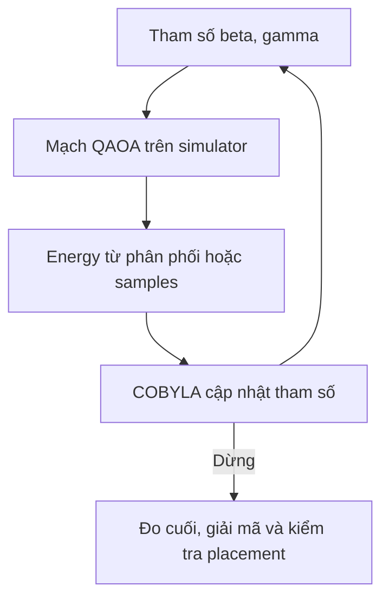

# Tổng kết Phase 4 — nhánh A và giải thích thuật ngữ, ký hiệu

Cập nhật ngày 13/10/2026. Phạm vi: công việc của Khiêm ở nhánh A, từ các thí nghiệm lặp lại Notebook 06 đến campaign test ba host Notebook 20. Không xác nhận công việc nhánh B/C. Theo lựa chọn mới nhất, không mở thêm đợt khảo sát trần laptop.

**Kết quả chính:** Phase 4 đã biến pipeline QUBO/Ising/QAOA có từ các phase trước thành một quá trình thực nghiệm có đối chứng, dữ liệu nguồn và kiểm tra. Mã hóa gọn hai host cải thiện rõ kết quả trên ba instance cố định; study ba host đã chạy đủ 90 lượt và đạt optimum ở 70% batch. Chưa có bằng chứng về ưu thế tính toán so với các thuật toán cổ điển giải bài toán placement.

## 1. Phase 4 nhằm trả lời điều gì?

Ở các phase trước, chúng ta xây bài toán, công thức QUBO/Ising và chạy QAOA ban đầu. Phase 4 kiểm tra các câu hỏi thực nghiệm:

1. Kết quả có lặp lại qua nhiều seed hay chỉ tốt ở một lần chạy?
2. Hệ số phạt, thang Hamiltonian, khởi tạo và độ sâu ảnh hưởng đến nghiệm thế nào?
3. Có thể phân biệt nhiễu lấy mẫu với việc optimizer chưa dùng đủ ngân sách không?
4. Tối ưu mean-energy hay CVaR có cải thiện placement thực tế không?
5. Thay mã hóa có giúp giảm qubit, tăng chất lượng và giảm chi phí mô phỏng không?
6. Khi thử ba host và 4–5 task, kết quả còn tốt đến đâu so với đối chứng?

Không sử dụng việc code chạy xong, optimizer báo success hay energy giảm làm bằng chứng thay thế cho chất lượng placement.

## 2. Toàn bộ tiến trình đã thực hiện

Các số lượt dưới đây mô tả từng đợt. Không cộng thành một số lượng mẫu độc lập: có đối chứng tái lập, dữ liệu cũ được tái sử dụng và nhiều lượt trên cùng instance.

| Notebook | Công việc đã làm | Phạm vi đã ghi nhận | Điều học được |
|---|---|---|---|
| 06 | Lặp QAOA với seed/khởi tạo cố định; lưu các báo cáo và kiểm tra tính nhất quán | 18 lượt trên tight, choice, reference | Một lượt chạy không đủ mô tả chất lượng; cần giữ cả các lượt không tìm thấy nghiệm. |
| 07 | Sweep penalty chung P=1,2,3,5,8 | 90 lượt: 60 tight/choice, 30 reference | Penalty mạnh hơn không tự làm xác suất placement tối ưu cao hơn. |
| 08 | Tách penalty gán task và penalty tài nguyên | 24 lượt pilot trên choice/reference | Có thể ưu tiên từng nhóm lỗi, nhưng ứng viên tốt ở một input chưa chắc tốt ở input khác. |
| 09 | Xác nhận ứng viên penalty bằng seed mới 45–49 | 20 lượt | Cặp (3,12) không có bằng chứng cải thiện đồng đều trên cả choice và reference. |
| 10 | Đổi thang Hamiltonian và kiểm tra khởi tạo tương đương/khởi tạo chung | 30 lượt trên hai input | Giảm năng lượng không đủ chứng minh tăng chất lượng; đổi đơn vị và đổi trạng thái đầu phải được phân biệt. |
| 11 | So p1/p2 với ngân sách cap80 và khởi tạo nhúng cùng trạng thái đầu | 20 lượt | p2 có thể giảm energy nhưng chưa tăng P_opt; optimizer dừng trước cap không đồng nghĩa optimum. |
| 12 | Tách mẫu cuối khỏi training; đối chứng sampled mean với exact mean | 8 lượt mỗi input, tổng 16 | Các phép đo cuối ở đợt cũ chưa độc lập với training; exact expectation là chẩn đoán mô phỏng, không phải giải chính xác placement. |
| 13 | Tăng cap80→cap200 cho hai lượt exact mean trên choice | 2 lượt mới | Hai lượt dừng số học sau 151/105 đánh giá, nhưng P_opt lý tưởng vẫn khoảng 0,12577%. |
| 14 | Đổi objective từ exact mean sang exact CVaR, alpha=0,1 trên choice | 2 lượt mới, dùng lại baseline Notebook 13 | Có thay đổi nhỏ về P_opt; chưa có bằng chứng cải thiện mạnh hoặc ổn định. Một lượt CVaR dùng hết cap200. |
| 15 | Đối chứng matched mean/CVaR trên p0_reference | 2 exact mean + 2 exact CVaR | Hiệu ứng ở choice không chuyển thành lợi ích tương tự ở reference. |
| 16 | Khóa bộ benchmark và giao thức chung: p1/p2/p3, năm seed | 45 lượt chính + 1 negative-control + 9 probe | Đủ ma trận nhưng chỉ 24/45 batch có optimum; p3 không thấy nghiệm khả thi trên tight/reference trong đợt này. |
| 17 | Mã hóa hai host bằng một bit/task, giữ input, y và slack | 45 lượt mới + 1 negative-control + 9 probe | Giảm 4 qubit mỗi instance; 45/45 batch có optimum; tổng trial time giảm rõ. Phải tính lại mốc random của mã hóa mới. |
| 18 | Audit kết quả 16/17; thêm đối chứng placement trực tiếp và timing cổ điển | Tổng hợp dữ liệu đã có; không huấn luyện lại QAOA | Thành công best-of-1.024 dễ bão hòa; cần đối chứng có tận dụng cấu trúc bài toán. |
| 19 | Xây mã hóa domain-wall ba host, chứng chỉ mô hình, dev pilot và kiểm tra chức năng | 12 lượt development + 2 functional smoke + 8 probe | Có thể triển khai test 4–5 task/3 host trong giới hạn tài nguyên; pilot không chứng minh lợi thế. |
| 20 | Test trên sáu instance đã khóa, p1/p2/p3, seed200–204, final seed riêng | 90 lượt test + 18 probe | 90/90 batch khả thi, 63/90 tối ưu; chất lượng chưa vượt random placement trực tiếp ở trung bình của 18 nhóm. |

**Mức bằng chứng:** các mốc 06–11 được đối chiếu với manifest và nhật ký review đã lưu trong nguồn backup. Tài liệu này không thực hiện lại toàn bộ audit raw samples của các mốc đó. Các báo cáo exact 12–15 và bảng 16–18 còn lưu được đọc để tổng hợp; kết quả 19 được đối chiếu với CSV và review, còn 20 đã có audit đầy đủ trước khi viết tổng kết. Những kết luận cũ cần giữ giới hạn phương pháp của thời điểm chúng được đo.

### Các công việc kỹ thuật xuyên suốt

Ngoài các lượt chạy, chúng ta đã triển khai kiểm tra công thức QUBO/Ising, thứ tự bit, ánh xạ tham số, nghiệm tham chiếu nhỏ và instance vô nghiệm; lưu cấu hình/runtime/nguồn; manifest và run key; resume bỏ qua lượt completed; trạng thái lỗi hoặc gián đoạn; probe tài nguyên; resource/time guard; bảng CSV/JSON và archive có SHA-256.

Đã kiểm tra test suite qua các mốc, xử lý vấn đề nhất quán manifest/resume và phân biệt khác biệt LF/CRLF với thay đổi nội dung mã. Log người dùng từng xác nhận 64 test có OK ở mốc trước; không dùng con số đó như số test của repository cuối cùng.

Chúng ta cũng đã đối chiếu nghiên cứu liên quan để điều chỉnh kỳ vọng: đánh giá cách mã hóa, objective, đối chứng và chi phí thực tế; không xếp hạng đồ án ngang một bài báo chỉ bằng một tỷ lệ thành công trên dữ liệu khác.

## 3. Bài toán gốc và từ điển ký hiệu

Một **task** đại diện cho VM/container cần CPU và RAM. Một **host** là máy chủ có capacity cố định. **Placement** là phương án đặt từng task lên một host.

Mục tiêu dự án là dùng ít host hoạt động nhất, đồng thời không chia task và không vượt CPU/RAM. Đây là bài toán tối ưu có ràng buộc; việc “có nghiệm khả thi” và “có nghiệm tối ưu” là hai yêu cầu khác nhau.

| Ký hiệu | Ý nghĩa | Cách đọc trong đồ án |
|---|---|---|
| n, m | Số task, số host | Ví dụ n=4,m=2. |
| i, h, r | Chỉ số task, host, tài nguyên | r thuộc {CPU,RAM}. |
| d_(i,r) | Nhu cầu tài nguyên r của task i | CPU hoặc RAM cần cấp. |
| C_(h,r) | Capacity tài nguyên r của host h | Giới hạn đã cố định trong input JSON. |
| x_(i,h) thuộc {0,1} | Biến gán task | 1: task i được đặt lên host h. |
| y_h thuộc {0,1} | Biến bật host | 1: host h hoạt động; host có task phải bật. |
| s_(h,r) >=0 | Slack tài nguyên | Phần dư trong phương trình dung lượng; là số nguyên mã hóa bằng bit. |
| b_a thuộc {0,1} | Bit thứ a trong toàn bộ mã hóa | Có thể là bit task, y hoặc slack. |
| f(x,y)=sum_h y_h | Objective gốc | Số host bật; cần tối thiểu hóa. |
| f* | Objective tối ưu chính xác | Nhỏ nhất trên mọi placement khả thi. |
| E(b) | Năng lượng QUBO | Objective gốc cộng penalty; không phải điện năng tiêu thụ. |
| lambda_assign, lambda_capacity | Hệ số phạt | Trọng số lỗi gán và lỗi phương trình tài nguyên. |
| P | Penalty chung trong các study đầu | Khi hai lambda đều bằng P. Không nhầm với P_opt là xác suất. |
| N hoặc q | Tổng số biến nhị phân/qubit logic | Tính cả y và slack, không chỉ n×m. |

### Các ràng buộc

Mỗi task được gán đúng một host:

\[
\sum_{h=0}^{m-1}x_{i,h}=1.
\]

Tài nguyên của host phải đủ và host có task phải bật:

\[
\sum_i d_{i,r}x_{i,h}\le C_{h,r}y_h.
\]

Với nhu cầu tài nguyên dương, nếu y_h=0 thì vế phải bằng 0, nên host đó không thể nhận task. Đầu ra có thể bật một host rỗng, nhưng sẽ bị objective sum(y) tính chi phí; random placement trực tiếp suy ra y từ các host thực sự được dùng.

Đưa bất đẳng thức về phương trình bằng slack:

\[
\sum_i d_{i,r}x_{i,h}+s_{h,r}-C_{h,r}y_h=0.
\]

Ví dụ host bật có CPU capacity5 và task dùng CPU3: slack đúng là2. Nếu placement và y giữ nguyên nhưng slack đo được là0, placement vẫn đủ CPU; phương trình QUBO có residual=-2 và bình phương lỗi bằng4.

Slack được viết thành tổng bit có trọng số, ví dụ capacity5:

\[
s=b_0+2b_1+2b_2.
\]

Các trọng số bị lặp có thể khiến một giá trị slack có nhiều biểu diễn bit. Điều này ảnh hưởng số trạng thái nền trong không gian bit; không làm bài toán placement có thêm phương án gán task.

## 4. QUBO, penalty và vì sao energy khác chất lượng nghiệm

**QUBO — Quadratic Unconstrained Binary Optimization:** tối ưu một đa thức bậc tối đa hai trên các biến 0/1. “Unconstrained” nghĩa là solver đọc một objective nhị phân không có constraint riêng; ràng buộc bài toán đã được đưa vào các số hạng phạt.

Mô hình one-hot dùng:

\[
E(x,y,s)=\sum_hy_h
+\lambda_{\mathrm{assign}}\sum_i\left(\sum_hx_{i,h}-1\right)^2
+\lambda_{\mathrm{capacity}}\sum_{h,r}
\left(\sum_i d_{i,r}x_{i,h}+s_{h,r}-C_{h,r}y_h\right)^2.
\]

One-hot là một hàng bit có đúng một số1. Ví dụ hai host: (1,0) và (0,1) hợp lệ; (0,0) bỏ task, (1,1) gán task hai lần.

Ví dụ một bitstring có sum(y)=2, tổng lỗi gán bằng1 và tổng lỗi phương trình tài nguyên bằng4. Với penalty(3,3), energy=2+3×1+3×4=17. Với penalty(12,3), energy=26. Cùng một bitstring được chấm khác nhau khi penalty thay đổi. Vì vậy không dùng raw mean-energy để xếp hạng hai study khác penalty.

Nếu placement khả thi, slack đúng thì cả hai nhóm phạt bằng0 và E=f. Nhưng trong phân phối đo có nhiều trạng thái vi phạm, nên tối ưu mean-energy là cân bằng toàn bộ probability mass, không trực tiếp tối đa hóa xác suất có placement tốt nhất.

Với dữ liệu nguyên, slack biểu diễn đủ và bài toán có nghiệm, min(lambda_assign,lambda_capacity)>m là một điều kiện đủ đơn giản cho mô hình one-hot: mỗi vi phạm tạo ít nhất một đơn vị lỗi bình phương, còn một nghiệm khả thi có E<=m. Điều kiện đủ không phải điều kiện cần. Trên hai host, P=3 đáp ứng lập luận này; nó không bảo đảm QAOA hữu hạn tìm được trạng thái nền.

### Hai khái niệm tối ưu cần tách

- **Placement optimum:** gán task và y hợp lệ, có f=f*. Bỏ qua việc bit slack đã khớp hay chưa khi chấm chất lượng vật lý.
- **QUBO ground state:** bitstring có E nhỏ nhất trên toàn bộ mã hóa, bao gồm slack. Khi mô hình được chứng nhận đúng, ground state giải bài toán gốc; chiều ngược lại không yêu cầu mọi cách điền slack của một placement tối ưu đều là ground state.

Ví dụ placement dùng2 host đúng optimum, slack sai: có thể đếm vào P_opt, nhưng không đếm vào P_ground. Notebook20 có 63 batch chứa placement tối ưu nhưng chỉ8 final shot đạt ground state QUBO; đây không phải mâu thuẫn.

## 5. Ising, Hamiltonian và QAOA

### Đổi bit sang spin

Với bit b_a và spin sigma_a:

\[
b_a=\frac{1-\sigma_a}{2},\qquad \sigma_a\in\{-1,+1\}.
\]

Bit0 tương ứng spin+1; bit1 tương ứng spin-1. Toán tử Pauli Z có các trị riêng đó. QUBO được đổi thành Hamiltonian chéo:

\[
\hat H_C=\sum_a h_a Z_a+\sum_{a<b}J_{ab}Z_aZ_b,
\qquad E(b)=c_I+\langle b|\hat H_C|b\rangle.
\]

h_a là hệ số một qubit, J_ab là hệ số tương tác hai qubit, c_I là offset hằng. Chỉ số a,b ở đây là vị trí qubit, không phải chỉ số task/host. Offset cần để khôi phục energy QUBO; một hằng số trong Hamiltonian chỉ tạo global phase khi tiến hóa và không đổi xác suất đo.

Các ký hiệu phép toán: sum/Σ là cộng theo chỉ số; mũ2 là bình phương; dấu mũ trên H chỉ toán tử; <psi|H|psi> là kỳ vọng của H ở trạng thái psi; ký hiệu tensor ⊗ ghép các hệ qubit. Chữ i trong exp(-i gamma H) là số ảo i^2=-1, khác chỉ số task i ở các ràng buộc.

**Hamiltonian** trong đồ án là toán tử biểu diễn hàm chi phí. Không diễn giải E là Joule hoặc điện năng của server. **Cost Hamiltonian** mã hóa QUBO; **mixer Hamiltonian** tạo chuyển động giữa các trạng thái trong không gian mã hóa.

### Vòng lặp QAOA

QAOA là Quantum Approximate Optimization Algorithm: chuẩn bị trạng thái lượng tử có tham số, đo/chấm energy và dùng optimizer cổ điển điều chỉnh tham số [L1]. Với X mixer:

\[
\hat H_M=\sum_a X_a,\quad
U_C(\gamma)=e^{-i\gamma\hat H_C},\quad
U_M(\beta)=e^{-i\beta\hat H_M}.
\]

\[
|\psi(\boldsymbol\beta,\boldsymbol\gamma)\rangle
=U_M(\beta_p)U_C(\gamma_p)\cdots
U_M(\beta_1)U_C(\gamma_1)|+\rangle^{\otimes N}.
\]

|+>=(|0>+|1>)/sqrt(2). Dấu ket |psi> biểu diễn trạng thái; bra <psi| là liên hợp chuyển vị. Ký hiệu tensor lũy thừa biểu diễn N qubit; không phải N bản sao của cả hệ.

| Ký hiệu/thuật ngữ | Ý nghĩa |
|---|---|
| p | Số lớp QAOA, không phải số qubit. p tăng làm thêm các lớp cost/mixer. |
| beta_l | Tham số điều khiển mixer ở lớp l. |
| gamma_l | Tham số điều khiển cost ở lớp l. |
| theta=(beta,gamma) | Toàn bộ tham số; QAOA chuẩn có 2p tham số. |
| X, Z | Toán tử Pauli: X trộn/lật bit trong cơ sở tính toán, Z chấm spin. |
| Ansatz | Họ mạch có tham số, ở đây là mạch QAOA. |
| P_theta(b)=abs(A_b)^2 | Xác suất đo bitstring b từ statevector. |
| Expectation | Trung bình theo phân phối trạng thái, không phải energy của một bitstring riêng. |

Một trạng thái tổng quát được viết |psi>=sum_b A_b|b>, với sum_b|A_b|^2=1. A_b là amplitude phức, không phải xác suất; xác suất là bình phương modulus của amplitude, theo Born rule. Trong mạch, RZ/RZZ là các cổng quay pha dùng cho các số hạng Z/ZZ; RX dùng cho X mixer. Bộ góc không phải dữ liệu CPU/RAM của task.

Pipeline chạy Aer trên CPU nên cả mô phỏng mạch và COBYLA đều chạy trên máy cổ điển. Trong phép so sánh của đồ án, “thuật toán cổ điển” chỉ các thuật toán giải trực tiếp bài toán placement, không chỉ nói đến COBYLA bên trong QAOA.

### Chuẩn hóa max_abs

Gọi kappa là trị tuyệt đối lớn nhất của các hệ số trong Hamiltonian không gồm offset. Thực thi H_exec=H_raw/kappa; chấm energy gốc theo E_QUBO=kappa×<H_exec>+c_I.

Để giữ cùng cost unitary tại cùng trạng thái đầu, phải đổi gamma_exec=kappa×gamma_raw. Chỉ chia Hamiltonian mà giữ nguyên gamma sẽ đổi mạch. Ngay khi trạng thái đầu được ghép đúng, hình học tìm kiếm của optimizer trong tọa độ mới cũng có thể khác. Notebook10 tách các trường hợp đó.

### COBYLA và các tham số dừng

COBYLA, Constrained Optimization BY Linear Approximation, là optimizer không cần gradient; dùng mô hình xấp xỉ cục bộ và trust region [L3].

| Tên trong report | Cách hiểu |
|---|---|
| nfev/cost_function_evals | Số lần thực tế objective được đánh giá. |
| maxiter/cap80/cap200 | Với COBYLA này, giới hạn số đánh giá hàm; không yêu cầu dùng đủ cap. |
| rhobeg | Bán kính ban đầu của trust region trong tọa độ tham số. |
| tol | Ngưỡng liên quan bán kính trust region; không phải dung sai objective placement hoặc bảo đảm optimality. |
| optimizer_success | Solver dừng theo điều kiện của nó; không chứng nhận optimum toàn cục. |
| stop_reason | Lý do dừng số học, hết cap, resource/time stop hoặc trạng thái khác. |

Năm seed cùng một initial point không phải năm khởi tạo khác nhau. **Multistart** chỉ dùng khi thực sự có nhiều điểm đầu. Hai khởi tạo common/alternative trong các study exact là hai quỹ đạo riêng; không biến thành nhiều lần tối ưu độc lập chỉ bằng đổi seed vốn không ảnh hưởng objective exact.

## 6. Shots, seed, mean-energy, exact và CVaR

### Shots và bitstrings

Một **shot** là một phép đo cho một bitstring. **Counts** ghi số lần từng bitstring xuất hiện. 1.024 shot không có nghĩa 1.024 lượt tối ưu. Ở simulator statevector lý tưởng, có thể chuẩn bị một trạng thái rồi lấy nhiều mẫu từ phân phối đó; không cần giữ đồng thời 1.024 statevector.

Bitstring Qiskit thường hiển thị qubit0 ở bên phải; vector biến trong mô hình lại được lưu theo danh sách variable_names. Chúng ta đã kiểm tra phép chuyển thứ tự trước giải mã. Không đọc chuỗi bit như danh sách task nếu chưa biết ánh xạ biến.

**Seed** điều khiển tính ngẫu nhiên để tái lập một cấu hình. Seed training dùng khi đánh giá trong tối ưu; seed evaluation dùng cho batch cuối. Ví dụ Notebook20: training200 và final100200. Seed riêng giúp tránh dùng lại cùng mẫu đánh giá đã ảnh hưởng việc chọn góc. Nó không tạo thêm một instance mới và không phải tham số góc.

### Sampled mean và exact mean

Với S shot và energy từng mẫu E_k:

\[
\widehat{E}_{\mathrm{mean}}=\frac{1}{S}\sum_{k=1}^{S}E_k.
\]

Với toàn bộ phân phối lý tưởng của một circuit:

\[
E_{\mathrm{exact}}=\sum_b P_\theta(b)E(b).
\]

Sampled mean có biến thiên do lấy mẫu hữu hạn ngay cả khi circuit không có lỗi phần cứng. **Shot noise** trong các study này không đồng nghĩa nhiễu cổng trên máy lượng tử thật. **Exact mean** tính kỳ vọng từ statevector, nhưng optimizer vẫn có thể mắc ở một cực trị cục bộ; exact expectation không phải exact placement optimum và cũng không phải MILP.

Ở các đợt 06–11, seed sampler cuối chưa tách khỏi training. Dữ liệu đó giữ giá trị lịch sử và công thức/giải mã, nhưng không dùng như bằng chứng đánh giá cuối độc lập. Notebook12 bổ sung seed cuối riêng, đối chiếu E_train/E_eval/E_exact và metadata dừng. Các campaign sau giữ nguyên nguyên tắc này.

### CVaR

CVaR là Conditional Value-at-Risk. Trong cách dùng để tối thiểu hóa của dự án, CVaR_alpha là energy trung bình của phần **alpha khối lượng xác suất có energy thấp nhất**, không phải alpha phần trăm số bitstring phân biệt và không phải chỉ giữ các placement khả thi. Dùng CVaR làm objective lượng tử là một hướng đã có trong nghiên cứu [L2].

Sắp energy E_j tăng dần với xác suất p_j:

\[
w_j=\min\left(p_j,\max\left(0,\alpha-\sum_{k<j}p_k\right)\right),
\quad \mathrm{CVaR}_{\alpha}=\frac{\sum_jw_jE_j}{\alpha}.
\]

Ví dụ E=[0,2,10], P=[0,05;0,20;0,75], alpha=0,1: lấy0,05 tại energy0 và0,05 tại energy2; CVaR=1. Mean của toàn phân phối là7,9. Với alpha=1, CVaR bằng mean. Notebook14–15 dùng exact CVaR để tách ảnh hưởng objective khỏi shot noise trong training; final batch vẫn lấy mẫu riêng.

Kết quả lý tưởng, phần trăm xác suất mỗi shot:

| Instance | Exact mean cap200: P_opt | Exact CVaR alpha0,1: P_opt | Diễn giải |
|---|---:|---:|---|
| choice | Khoảng0,12577% ở cả hai start | Khoảng0,15022–0,15192% | Tăng nhỏ ở các góc cuối quan sát; chỉ hai start, một lượt CVaR hết cap200. Chưa đủ kết luận cải thiện ổn định. |
| reference | Khoảng0,20463% ở cả hai start | Khoảng0,13675–0,13693% | CVaR thấp hơn mean về P_opt trong đối chứng này. |

Các con số trên là P_opt tính từ phân phối tại góc cuối, không phải tần suất đo 1.024 shot. Không gộp chúng với các xác suất sampled vào một bảng mà bỏ nhãn. CVaR vẫn chấm QUBO có slack; không trực tiếp tối ưu sự kiện placement đạt optimum.

## 7. Thay mã hóa đã giúp gì?

### Hai host — Notebook17

One-hot cần hai bit/task. Với hai lựa chọn, dùng một bit t_i:

\[
x_{i,0}=1-t_i,\qquad x_{i,1}=t_i.
\]

Mỗi giá trị t_i tự tạo đúng một host, nên loại được biểu diễn vi phạm gán task. Trong code bit chọn này có thể mang tên z_i; nó là bit0/1, khác spin sigma_a=±1 ở mục Ising.

Với bốn task, giảm8 bit gán xuống4 bit. Các bit y giữ mục tiêu bật host; slack vẫn cần biểu diễn phương trình CPU/RAM. Không có lý do giảm số bit slack nếu capacity và cách biểu diễn slack giữ nguyên.

| Instance | One-hot Notebook16 | Mã hóa gọn Notebook17 | Chênh lệch |
|---|---:|---:|---:|
| choice | 20 qubit | 16 qubit | -4 |
| tight | 18 qubit | 14 qubit | -4 |
| reference | 23 qubit | 19 qubit | -4 |

Giảm4 qubit làm kích thước **một statevector** giảm16 lần. Tổng RSS process không giảm16 lần vì còn Python, thư viện và các đối tượng khác.

Đối chiếu trên cùng ba input và ma trận p/seed:

| Chỉ tiêu | Notebook16 | Notebook17 |
|---|---:|---:|
| Batch có placement khả thi | 29/45 | 45/45 |
| Batch có placement tối ưu | 24/45 | 45/45 |
| Tổng thời gian bên trong45 trial | 1.108,53 giây | 199,46 giây |

P_opt tăng ở cả chín nhóm instance/p. Tổng thời gian trial quan sát giảm khoảng5,56 lần; các campaign chạy khác thời điểm nên đây không phải bảo đảm speedup phổ quát. Encoding mới đồng thời đổi Hamiltonian, không gian trạng thái đầu, normalization và ý nghĩa X mixer; không quy toàn bộ cải thiện cho một nguyên nhân duy nhất là ít qubit.

### Ba host — Notebook19–20

Domain-wall dùng hai bit u_i,v_i, với miền hợp lệ u_i>=v_i:

| u_i v_i | Host được chọn | x_(i,0),x_(i,1),x_(i,2) |
|---|---|---|
| 00 | h0 | (1,0,0) |
| 10 | h1 | (0,1,0) |
| 11 | h2 | (0,0,1) |
| 01 | Không hợp lệ | (1,-1,1) trong biểu thức đại số; không phải placement |

Ánh xạ là x_i=(1-u_i,u_i-v_i,v_i). Penalty domain4×v_i(1-u_i) phạt nhãn01. Không cố giải mã nhãn đó thành một host thật hoặc sửa bit để cứu mẫu.

Ba lựa chọn one-hot cần3 bit/task; domain-wall cần2. Với4/5 task, tiết kiệm4/5 qubit so với mô hình one-hot tương ứng. Nghiên cứu này giữ y/slack và capacity; X mixer vẫn có thể đưa probability mass vào nhãn01, nên domain-wall không tự bảo toàn mọi ràng buộc.

Tổng qubit test20 là20,22,22 cho các case4 task và24,24,25 cho các case5 task. Chứng chỉ kiểm tra đa thức QUBO mới bằng energy công thức/ánh xạ; reference duyệt3^n placement và xử lý slack riêng để tránh phải vét cạn toàn bộ2^N bitstring.

## 8. Đọc đúng các chỉ số chất lượng và đối chứng

Đặt V là tập bitstring có placement khả thi, O là tập có placement đạt f*, G là tập trạng thái nền QUBO. Với mẫu cuối:

\[
\widehat P_{\mathrm{feasible}}=\frac{N_V}{S},\qquad
\widehat P_{\mathrm{opt}}=\frac{N_O}{S},\qquad
\widehat P_{\mathrm{ground}}=\frac{N_G}{S}.
\]

P_feasible cần đúng assignment/domain, y và capacity vật lý. P_opt còn cần ít host nhất. P_ground xét thêm energy của toàn bộ bit, gồm slack.

| Chỉ số | Định nghĩa | Lỗi đọc thường gặp |
|---|---|---|
| P_opt mỗi shot | Tỷ lệ shot có nghiệm tối ưu, hoặc xác suất lý tưởng được ghi nhãn riêng | Nhầm với tỷ lệ lượt tối ưu. |
| found_optimal / batch success | Batch có ít nhất một shot tối ưu | Nhầm1.024 shot là1.024 lần tối ưu. |
| observed_run_success | Số batch thành công/số lượt trong study | Xem nhiều seed cùng instance như nhiều bài toán độc lập. |
| Gap | f_selected-f*, khi có nghiệm khả thi và optimum tồn tại | Gán0 khi không có nghiệm; đúng ra cần null. |
| Mean energy | Trung bình E trên tất cả shot/phân phối | Xem giảm energy là tăng P_opt. |
| Mode | Bitstring có counts cao nhất; có thể đồng hạng | Tùy ý chọn một mode hợp lệ rồi gọi là mode duy nhất. |
| Best-valid | Nghiệm khả thi tốt nhất trong batch theo quy tắc protocol | Gọi nó là kết quả của một shot hoặc của mode. |
| Lift | P_opt,QAOA/P_opt,control | Dùng mốc quá yếu rồi tuyên bố thắng mọi thuật toán cổ điển. |

Ví dụ batch1.024 có3 mẫu tối ưu: P_opt đo được=3/1024≈0,293%, nhưng found_optimal=True. Nếu cả90 batch có một mẫu khả thi, success khả thi là100%; tỷ lệ shot khả thi vẫn có thể rất thấp.

**Best-valid là hậu xử lý có chấm các mẫu**, không sửa task/y/slack. Quy tắc này khác mô tả most-frequent trong proposal, cần công bố. Các study giữ tie-break của protocol tương ứng; không thay quy tắc sau khi xem kết quả.

### Ba loại đối chứng

1. **Uniform encoded:** lấy bit đều trong mã hóa đang xét. Có thể tạo assignment/domain hoặc y không hợp lệ. Đây là mốc phân phối của encoding.
2. **Random placement có cấu trúc:** chọn host đều cho từng task, suy ra y, kiểm tra capacity; không sửa overload. Đây là một thuật toán cổ điển trực tiếp cho bài toán gốc.
3. **Exact enumeration:** duyệt mọi m^n placement và lấy nghiệm khả thi có ít host nhất. Là exact reference/solver nhỏ, khác phương pháp MILP mà topic yêu cầu.

Nếu một phân phối đối chứng cố định có xác suất P_opt đã biết và lấy S mẫu IID:

\[
P(\text{batch có optimum})=1-(1-P_{\mathrm{opt}})^S.
\]

IID nghĩa là các mẫu độc lập và cùng phân phối. Không đưa P_opt trung bình của nhiều circuit QAOA khác nhau vào công thức này rồi gọi đó là success thật của cả study. Với QAOA, báo batch outcome đã quan sát và thống kê theo instance/p/seed.

**Vì sao45/45 ở Notebook17 chưa là quantum advantage?** Uniform của encoding mới cũng tăng P_opt16 lần so với one-hot. Với1.024 shot, xác suất batch có optimum của uniform mã hóa gọn đã gần100% ở các instance này. Tuy vậy, QAOA p3 của tight/reference vẫn có P_opt trung bình cao hơn random placement trực tiếp:30,352% so với25%, và7,305% so với6,25%. Đây là cải thiện phân phối ở hai nhóm; chưa chứng minh giải nhanh hơn vì cần cả chi phí tối ưu tham số.

### Các baseline được giảng viên yêu cầu

- **First-Fit (FF):** thử các host theo thứ tự, đặt task vào host đầu tiên đủ CPU/RAM.
- **Best-Fit Decreasing (BFD):** xét task theo thứ tự giảm dần của một quy tắc độ lớn, chọn host vừa khít theo tiêu chí đã định. Với hai tài nguyên phải đặc tả cách sắp task và cách đo độ khít; không có một quy tắc duy nhất mặc định.
- **MILP:** Mixed-Integer Linear Programming, mô hình tuyến tính có biến nguyên/nhị phân. Solver chỉ được gọi là cho optimum khi trạng thái/bound của nó chứng nhận điều đó.

Nhánh A hiện có random placement và exact enumeration để đối chiếu. Không xem chúng là đã triển khai đầy đủ FF/BFD/MILP, và không tự xác nhận kết quả B/C.

## 9. Kết quả cuối của study ba host

Notebook19 là development/pilot: hai instance, hai seed mỗi p,12 lượt chính;8/12 batch có optimum và12/12 có nghiệm khả thi. Hai functional smoke nằm ngoài mẫu số đó. Notebook20 dùng sáu instance test khác và năm seed mỗi p; không lấy66,7%→70% làm bằng chứng nâng cấp thuật toán.

| Chỉ tiêu Notebook20 | Kết quả đã audit |
|---|---:|
| Test trial / probe | 90/90 completed;18/18 passed |
| Final shots | 92.160 |
| Batch có placement khả thi | 90/90 |
| Batch có placement tối ưu | 63/90 —70% |
| Đầu ra2 host /3 host | 63 /27 lượt |
| Optimum của sáu instance | Đều là2 host |
| Objective đầu ra trung bình | 2,3 host |
| Tỷ số f_selected/f* trung bình | 1,15, mô tả quan sát; không phải bảo đảm xấp xỉ |
| Tổng nfev | 3.945;27–75 mỗi trial |
| Tổng algorithm shot | 4.224.000, gồm training/batch bổ sung/final |
| QUBO ground-state final shot | 8 |

| Quy mô | p | Batch có optimum | P_opt trung bình/shot | Trung vị trial time |
|---|---:|---:|---:|---:|
| 4 task/3 host | 1 | 7/15 | 0,0781% | 11,46s |
| 4 task/3 host | 2 | 12/15 | 0,1367% | 24,79s |
| 4 task/3 host | 3 | 10/15 | 0,0977% | 41,96s |
| 5 task/3 host | 1 | 10/15 | 0,1758% | 62,91s |
| 5 task/3 host | 2 | 12/15 | 0,2539% | 143,42s |
| 5 task/3 host | 3 | 12/15 | 0,2799% | 302,61s |

Mỗi dòng gồm ba instance×năm seed. p1/p2/p3 đạt17/30,24/30,22/30 batch tối ưu khi gộp quy mô. p2 có số batch thành công cao nhất quan sát; đây không phải việc chọn p đã đăng ký trước hoặc chứng minh p2 luôn tốt nhất.

Lift encoded trung bình của18 nhóm từ0,8 đến20,8;15 nhóm>1, một nhóm=1 và hai nhóm<1. Nhưng cả18 nhóm có P_opt trung bình thấp hơn random placement trực tiếp. Kỳ vọng giải tích ở1.024 mẫu đối chứng/batch là khoảng43,58/90 batch tối ưu cho bit đều và89,997/90 cho random placement; hai số này không phải kết quả quan sát từ90 lượt solver.

Một ví dụ energy/placement: n5_2 từ p2→p3 có mean-energy234,91→139,97, trong khi P_opt0,1953%→0,0977%. Phân rã raw counts cho thấy capacity/slack penalty chiếm khoảng97,28% tổng mean-energy cộng của90 batch. Thành phần đó gộp cả lỗi tài nguyên/y và slack không khớp; không gọi toàn bộ là slack lãng phí hoặc quy nó là nguyên nhân duy nhất.

## 10. Tài nguyên, tính tái lập và những phần chưa hoàn thành

Một statevector complex128 có2^N amplitude phức,16 byte/amplitude; riêng vector cần16×2^N byte. N=25 cần512MiB. Không dùng tỷ lệ RAM tổng hệ thống trên Task Manager làm RAM riêng của Python.

**RSS** là bộ nhớ resident của process. **Lifetime peak RSS** là đỉnh trong cả vòng đời kernel, có thể gồm hoạt động trước trial. **Available RAM** là bộ nhớ hệ thống có thể cấp phát; đo tại boundary có thể bỏ lỡ đỉnh bên trong lời gọi native. **MiB/GiB** dùng2^20/2^30 byte, khác MB/GB thập phân.

Notebook20 ghi peak RSS702,24MiB và available thấp nhất12,01GiB ở các mốc. Tổng trial time12.212,19s; tổng thời gian tính vào ngân sách các stage12.515,77s, khoảng3 giờ28 phút36 giây. Sau đó người dùng cho biết máy đã vào sleep/chế độ ngưng trong quá trình chạy; một trial có khoảng trống log32,14 phút. Giữ số đo gốc, ghi rằng nó gồm thời gian chờ; không tự trừ toàn bộ khoảng trống thành runtime sạch.

Timing cổ điển test20: vét cạn khoảng0,134–0,448ms và random1.024 placement khoảng3,17–3,74ms, theo phép đo warm-process. **Warm-process** nghĩa process đã khởi động; imports/calibration/reference prep không tính vào solver timing. QAOA trial time gồm optimization, final sampling và postprocessing. Không công bố một tỷ số speedup end-to-end từ phạm vi đo khác nhau. Dữ liệu hiện tại không hỗ trợ kết luận simulated QAOA nhanh hơn các đối chứng này.

| Thuật ngữ quản lý thí nghiệm | Ý nghĩa |
|---|---|
| Instance | Một bài toán với task/host/capacity cụ thể. |
| Trial/run | Một cấu hình instance, p, seed, objective và ngân sách được chạy. |
| Campaign | Một tập trial cùng protocol và ledger. |
| Protocol | Thiết kế cố định trước chạy: input, cấu hình, thứ tự, metric, output rule. |
| Pilot/development | Thí nghiệm để kiểm tra phương pháp/tài nguyên; không thay kết quả test. |
| Frozen/held-out test | Input và quy tắc được khóa trước khi tối ưu test; không chọn lại vì kết quả thấp. |
| Probe/preflight | Phép đo kiểm tra chi phí/tài nguyên trước training; không đưa vào success rate chính. |
| Manifest | Chỉ mục cấu hình và báo cáo đã hoàn tất. |
| Run key | Định danh để tránh trộn cấu hình hoặc chạy lại lượt completed. |
| Resume/checkpoint | Tiếp tục từ trạng thái đã lưu, giữ nguồn/input/protocol tương thích. |
| SHA-256/fingerprint | Kiểm tra định danh nội dung; không chứng minh thuật toán có ích. |
| Audit/PASS | Kiểm tra dữ liệu và phép tính nhất quán; không phải optimum hoặc quantum advantage. |
| SD | Độ lệch chuẩn mô tả các seed; không tự là khoảng tin cậy theo instance. |
| CI | Khoảng tin cậy; study20 không coi90 lượt là90 instance độc lập để xây CI. |
| TTS | Time to solution ở một mức thành công đã nêu; chưa được chứng nhận bằng mean P_opt gộp trong study này. |
| Quantum advantage | Lợi ích tính toán được chứng minh so với đối chứng cổ điển phù hợp; chưa đạt trong đồ án. |

### Đối chiếu Topic16 của giảng viên

| Yêu cầu | Trạng thái theo bằng chứng nhánh A |
|---|---|
| Instance4–8 task/2–4 host | Đạt với các instance nằm trong khoảng; topic không buộc chạy mọi kích thước hay bắt buộc8/4. |
| One-hot QUBO và capacity penalty | Đạt mô hình gốc; encoding gọn được công bố là mở rộng. |
| QAOA simulator và giải mã | Đạt. |
| FF/BFD/MILP trên cùng instance | Chưa xác nhận từ dữ liệu nhánh A; ngoài phạm vi triển khai A hiện tại. |
| Báo cáo quality/feasibility/qubit và giới hạn laptop | Có dữ liệu; không khảo sát thêm trần laptop theo lựa chọn mới nhất.25qubit là lớn nhất đã chạy trong protocol, không phải trần vật lý đã chứng minh. |

Đề cương nhóm có thêm nghiên cứu độ nhạy penalty; chúng ta đã có các đợt penalty06–09 trên one-hot lịch sử. Chúng không tự chứng nhận độ nhạy penalty của encoding domain-wall ba host. Topic của giảng viên không có một đầu việc riêng bắt buộc sweep penalty, nên không mở thêm sweep chỉ để gọi topic hoàn thành.

Các việc tiếp theo trong phạm vi A là biên tập kết quả/thảo luận vào báo cáo, gắn yêu cầu với artifact, chuẩn hóa hướng dẫn tái lập và snapshot bàn giao. Không cần chạy lại19–20 cho chất lượng; không tiếp tục mở rộng tài nguyên hoặc tuning test trong tổng kết này. Hoàn tất campaign A không đồng nghĩa đã hoàn tất mọi baseline của toàn nhóm hoặc đạt mục tiêu tốc độ.

## 11. Kết luận dùng cho báo cáo

Phase4 cho thấy cách biểu diễn bài toán và cách đánh giá có ảnh hưởng lớn đến kết quả mô phỏng QAOA. Trên ba instance hai host cố định, mã hóa gọn giảm4 qubit, tăng P_opt ở cả chín nhóm và giảm tổng trial time quan sát. Đối chứng có cấu trúc cho thấy success best-of-1.024 dễ bão hòa, nên kết quả45/45 không tự chứng minh ưu thế lượng tử. Trên sáu instance4–5 task/3 host, đủ90 trial luôn có placement khả thi trong final batch và đạt optimum ở70% lượt, nhưng trung bình nhóm chưa vượt random placement trực tiếp. Tăng p và giảm mean-energy không cải thiện đồng đều chất lượng placement. Đồ án cung cấp một đánh giá định lượng và có thể kiểm tra trong phạm vi mô phỏng đã chạy; chưa chứng minh lợi thế tính toán hoặc scaling tổng quát.

## 12. Nguồn và phạm vi sử dụng

**Nguồn dữ liệu dự án**

- Topic16 trong `NT409_26_Suggested_Project_Proposals.pdf`, trang10–11; `nt409-topic16-proposal.pdf`, mục3/5/6.
- Nguồn backup `jkay2005/nt409-task-placement`, nhánh `backup/a-notebook18-20261012`, commit `dae62dc5ba49decec2bd23890d7d36ee753beaae`: docs, tasks/plan.md, manifest và các reference_results lịch sử. Trạng thái pending trong kế hoạch cũ không thay dữ liệu hoàn tất ở manifest/review mới hơn.
- `notebook16_branch_a_review.md`; `notebook17_branch_a_review_20261011.md`; CSV của hai campaign và `summary_20261011T093559932161Z/summary.json`.
- `nt409_notebook19_windows_review_20261012.md`, `pilot_results.csv`, `assessment.json`.
- `test_20261012T112947210418Z.zip` và `nt409_notebook20_windows_review_20261013.md`; SHA-256 archive20: `c5f96510fad1007c9d7de185623e379e8416a59e3689bd0fdb3dbe8a9f49be19`.

**Nguồn thuật ngữ/phương pháp**

- Bài giảng `NT409-W2 Mathematical Foundations for Quantum Computing V1.0.pdf`: complex amplitudes, bra/ket, tensor product, Born rule và toán tử; `NT409-W1 Introduction to Quantum Computing Applications V1.0.pdf`: simulator và vòng lặp hybrid. Không áp dụng mô tả trực giác về superposition thành tuyên bố vét cạn miễn phí.
- [L1] Farhi, Goldstone, Gutmann, [A Quantum Approximate Optimization Algorithm](https://arxiv.org/abs/1411.4028),2014. Dùng để dẫn nguồn QAOA, không chuyển bảo đảm MaxCut sang placement.
- [L2] Barkoutsos et al., [Improving Variational Quantum Optimization using CVaR](https://arxiv.org/abs/1907.04769),2019/2020. Dùng để dẫn nguồn objective CVaR, không giả định kết quả đồ án phải giống kết quả bài báo.
- [L3] [SciPy minimize(method='COBYLA')](https://docs.scipy.org/doc/scipy/reference/optimize.minimize-cobyla.html): ý nghĩa rhobeg/tol/maxiter và trust region.
- [L4] [Qiskit AerSimulator](https://qiskit.github.io/qiskit-aer/stubs/qiskit_aer.AerSimulator.html): statevector, precision, threads và max_memory_mb. Phiên bản thực tế được giữ trong từng report.

Tài liệu không chạy lại training, không trộn các lượt QA Linux vào chất lượng Windows và không xác nhận một nguyên nhân duy nhất của các kết quả kém. Các số liệu là mô tả các instance đã chọn, có seed lồng trong instance. Máy tính lượng tử thật và study mở rộng trần laptop chưa thực hiện trong phạm vi này.
